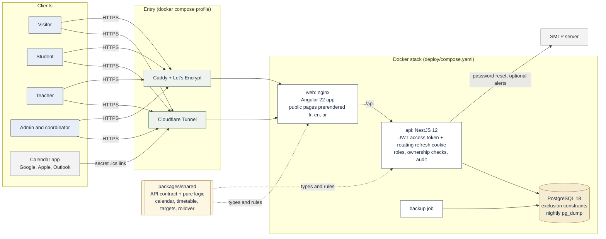
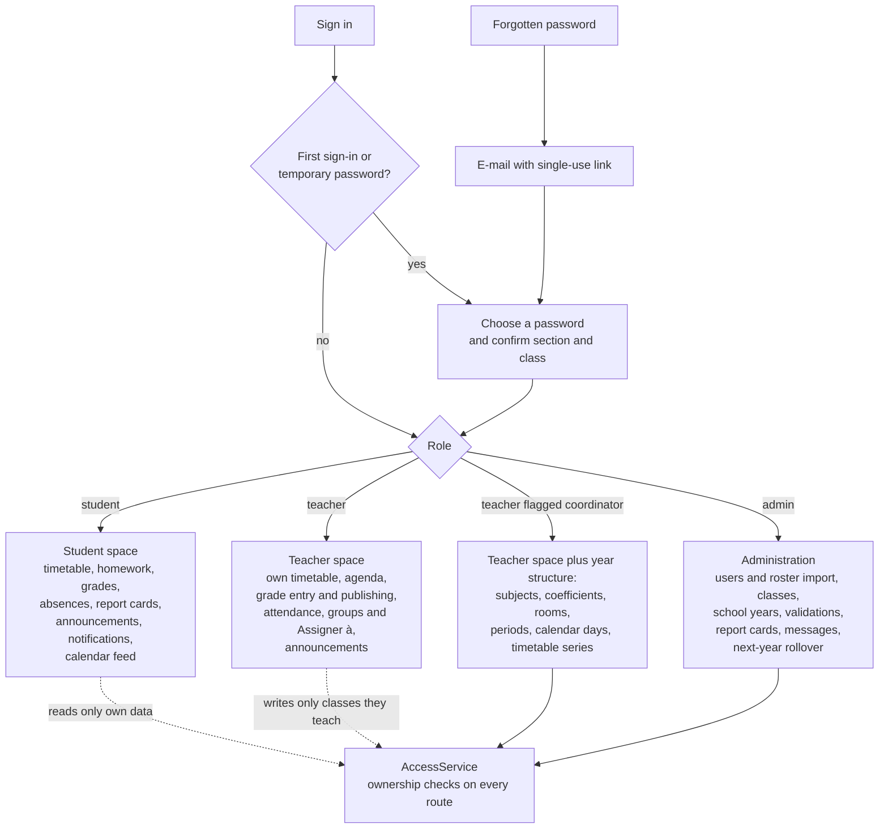
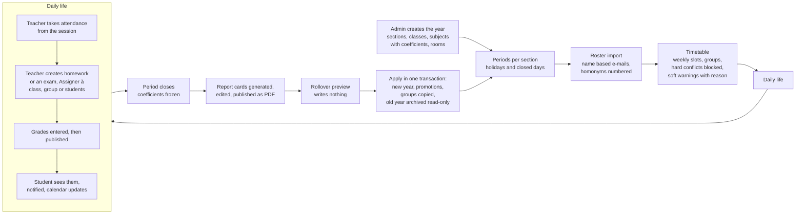
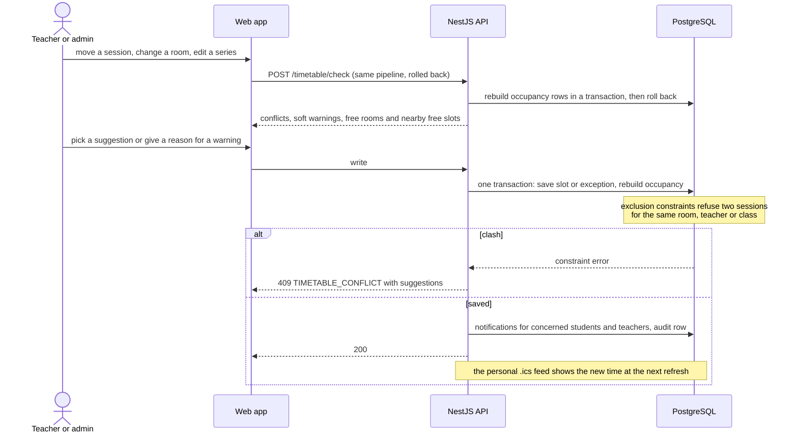
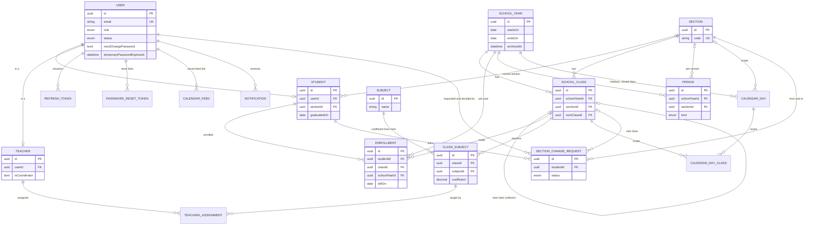
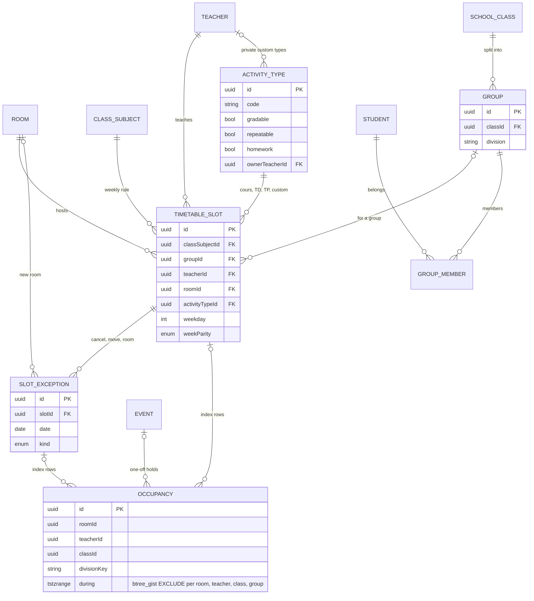
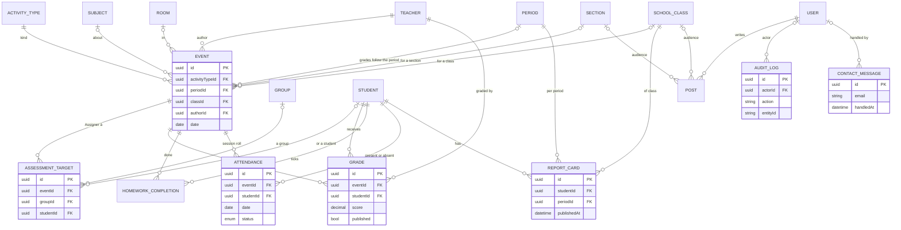

# CDLS: architecture, workflows and database schema

Diagrams are [Mermaid](https://mermaid.js.org/): GitHub draws them in the page, and they live in the repository as
text, so they change with the code. The schema diagrams follow `apps/api/prisma/schema.prisma` (the source of truth);
update them when a migration changes a table. Keys and the main columns are shown, not every column.

## 1. System

## 2. Who can do what

## 3. A school year, end to end

## 4. A change to the timetable

## 5. Database schema

The 13 enums are not drawn: `Role`, `RoomKind`, `PeriodKind`, `CalendarDayType`, `UserStatus`, `SectionChangeStatus`,
`TargetScope`, `AttendanceStatus`, `WeekParity`, `SlotExceptionKind`, `OccupancySource`, `NotificationKind` and
`NotificationMailState`.

### 5.1 People, school years, classes

### 5.2 Timetable, groups, rooms

### 5.3 Work, grades, attendance, communication

## 6. Where things live

| What | Where |
|---|---|
| REST contract and pure logic | `packages/shared/src/` |
| API modules, guards, services | `apps/api/src/` (one folder per feature), conventions in `apps/api/CLAUDE.md` |
| Schema and migrations | `apps/api/prisma/schema.prisma`, `apps/api/prisma/migrations/` |
| Web app and design system | `apps/web/src/app/`, conventions in `apps/web/CLAUDE.md`, tokens in `apps/web/src/styles/` |
| Deployment | `deploy/`, `docs/deployment.md` |
| Design decisions and leftovers | `docs/school-year-design.md` |
