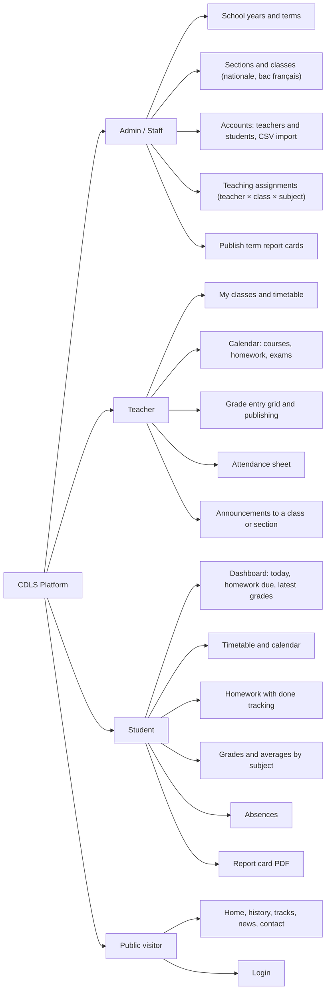
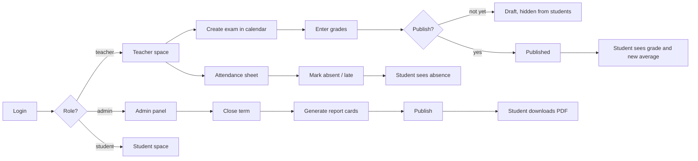
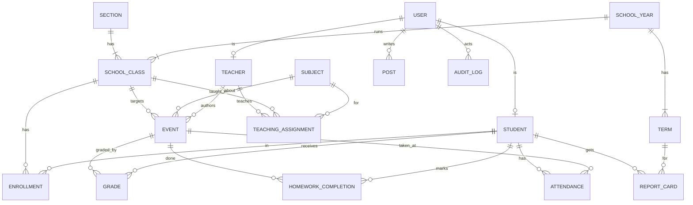
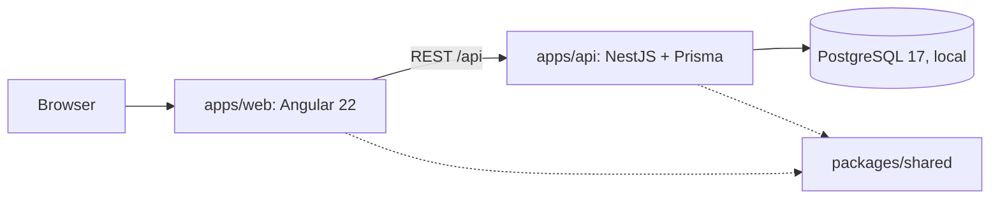

# CDLS — Product brainstorm

Versioned copy of the FigJam board: https://www.figma.com/board/OQ518A0iBOWrry0cahLyfC

Scope: one school (Collège de la Salle, Daher). Roles: admin/staff, teacher, student. Not in scope yet: parent space, Docker/deployment.

## 1. Roles and feature map

## 2. Key user flows

## 3. Sitemap

| Public | Student `/eleve` | Teacher `/enseignant` | Admin `/admin` |
|---|---|---|---|
| Accueil, Histoire, Bac nationale, Bac français, Actualités, Contact, Connexion | Tableau de bord, Emploi du temps, Devoirs, Notes, Absences, Bulletins | Mes classes, Agenda, Saisie des notes, Appel, Annonces | Années et trimestres, Classes, Utilisateurs + import CSV, Affectations, Bulletins |

## 4. Data model (PostgreSQL)

Mapping from today's Firestore code: `Grade` and `averageOnTwenty` ([space.model.ts](../src/app/space/space.model.ts)) → `GRADE`; `CalendarEvent` and `EventKind` ([calendar.model.ts](../src/app/space/calendar.model.ts)) → `EVENT`; `students.done[]` → `HOMEWORK_COMPLETION`; `firestore.rules` → the API's role guards.

## 5. Architecture and agent lanes

| Lane | Owns | Starts when |
|---|---|---|
| Lead (main session) | plan, contracts in `packages/shared`, merges | now |
| A: Design | brand research, Figma design system and screens | board signed off |
| B: Backend | `apps/api/**` | monorepo scaffold merged |
| C: Public site | `apps/web/.../public/**`, `ui/**` | design tokens ready |
| D/E: Spaces | student, teacher, admin folders | UI components merged |

At most 3 lanes at once. Every PR gets `/code-review`. Corrections go into `CLAUDE.md` or `.claude/skills/` so later agents follow them.

## 6. Roadmap

1. Board sign-off + skills setup
2. Lane A: brand → design system → screens · Lane B in parallel: scaffold → Prisma schema + seed → auth → feature modules
3. Lanes C/D/E: UI components → public site → student, teacher, admin spaces
4. Axe audit + Playwright e2e
